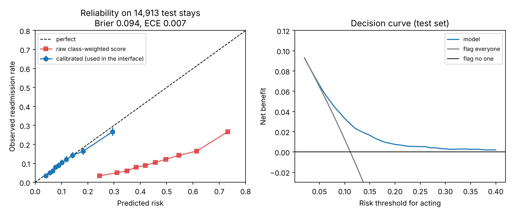
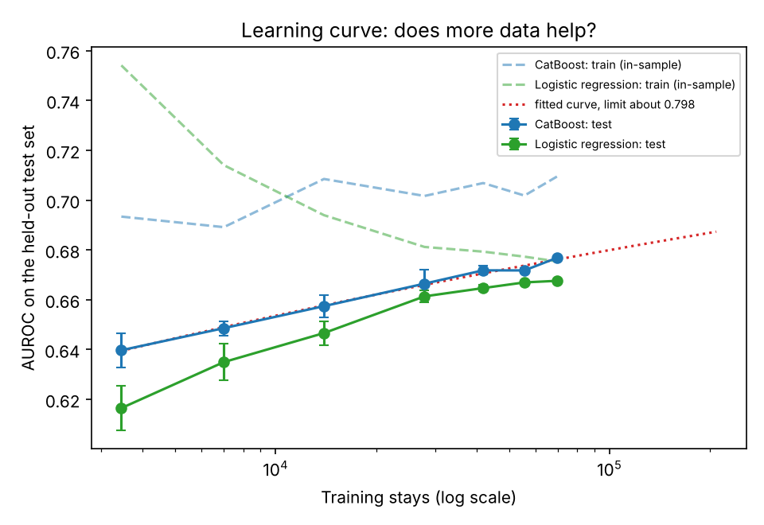
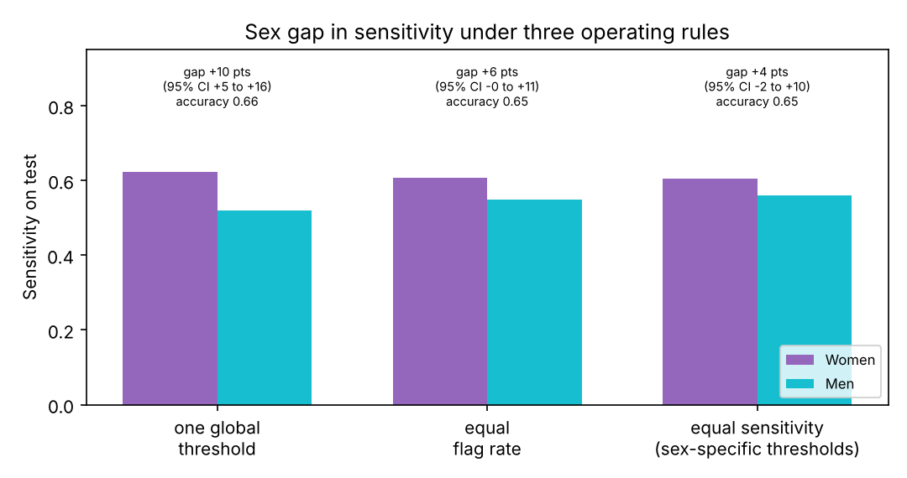

# Calibration, decision curves and subgroup audit

Script `scripts/18_calibration_subgroups.py`, final model (CatBoost + Platt calibration, the one in the interface), **test set only** (14,913 stays, 11.1% readmitted), patient-level bootstrap (500 resamples) for every interval. The operating threshold (11.6% calibrated risk) was chosen on validation data. Accuracy is always shown with sensitivity; the always-"no" accuracy is 0.889.

## 1. Calibration
| Measure | Value | Meaning |
|---|---|---|
| Brier score, calibrated | **0.094** | lower is better; always predicting the 11.1% average gives 0.099 |
| Brier score, raw class-weighted score | 0.219 | class weighting inflates the scores, which is why we calibrate |
| Expected calibration error | 0.007 | average gap between predicted and observed risk across 10 bins |
| Calibration slope | 0.96 | 1.0 is ideal; slightly over-confident |
| Calibration intercept | -0.13 | slightly over-predicts on average |

**Reading:** after calibration, a predicted risk of 10% really corresponds to about 10% of such patients being readmitted (left panel, blue). The raw score is badly miscalibrated (red) and must not be read as a probability. The model slightly over-predicts for the highest-risk patients.

## 2. Decision curve (net benefit)
Net benefit weighs the readmissions caught against false alarms at the risk threshold a care team would act on. The model has a higher net benefit than flagging everyone or no one across the whole range 2%-40%, but the advantage is small at the lowest thresholds, where flagging nearly everyone is almost as good.

| If you act on patients with risk of at least | Share flagged | Net benefit, model | Net benefit, flag everyone |
|---|---|---|---|
| 10% | 46% | 0.033 | 0.012 |
| 15% | 22% | 0.017 | -0.046 |
| 20% | 12% | 0.007 | -0.111 |
| 30% | 4% | 0.003 | -0.270 |

The model is most useful when interventions are costly enough that you want to target the top 10-25% of patients; the absolute gain is modest.

## 3. Subgroup audit (`subgroup_performance.csv`)
At the operating threshold. Positives = readmitted stays in that group. "Too few" = fewer than 30 readmissions.

| Group | n | Readmitted | AUROC (95% CI) | Accuracy | Sensitivity (95% CI) | Specificity | Precision |
|---|---|---|---|---|---|---|---|
| **Race** | | | | | | | |
| Caucasian (largest) | 11,160 | 1,267 | 0.671 (0.652-0.692) | 0.650 | 0.571 (0.538-0.606) | 0.660 | 0.177 |
| African American | 2,775 | 295 | 0.692 (0.656-0.728) | 0.651 | 0.617 (0.551-0.682) | 0.655 | 0.175 |
| Hispanic | 305 | 31 | 0.742 (0.635-0.845) | 0.731 | 0.548 (0.357-0.750) | 0.752 | 0.200 |
| Unknown | 339 | 34 | 0.643 (0.544-0.740) | 0.726 | 0.382 (0.208-0.535) | 0.764 | 0.153 |
| Other | 233 | 22 | too few | 0.717 | too few | 0.730 | 0.186 |
| Asian | 101 | 9 | too few | 0.743 | too few | 0.772 | 0.160 |
| **Sex** | | | | | | | |
| Female | 8,079 | 889 | 0.694 (0.670-0.716) | 0.648 | **0.622** (0.580-0.662) | 0.652 | 0.181 |
| Male | 6,834 | 769 | 0.658 (0.634-0.681) | 0.664 | **0.519** (0.476-0.555) | 0.682 | 0.171 |
| **Age** | | | | | | | |
| under 50 | 2,363 | 246 | 0.721 (0.668-0.772) | 0.737 | 0.585 (0.485-0.688) | 0.754 | 0.217 |
| 50-69 | 5,832 | 622 | 0.695 (0.670-0.718) | 0.700 | 0.548 (0.502-0.589) | 0.719 | 0.189 |
| 70-79 | 3,823 | 428 | 0.645 (0.618-0.673) | 0.594 | 0.586 (0.538-0.638) | 0.594 | 0.154 |
| 80+ | 2,895 | 362 | 0.635 (0.606-0.668) | 0.580 | 0.597 (0.547-0.650) | 0.578 | 0.168 |

**What the audit shows**
1. **Sex gap in sensitivity:** the model catches about 62% of women's readmissions but only about 52% of men's, a difference of roughly 10 points whose confidence intervals do not overlap (equal-opportunity gap). Overall AUROC is also lower for men (0.658 vs 0.694). A real disparity to report and, if the model were ever used, to investigate.
2. **Race:** no reliable difference between Caucasian and African American patients (sensitivity 0.571 vs 0.617, overlapping intervals; AUROC 0.671 vs 0.692). Hispanic, Other and Asian groups are too small to conclude anything, and the wide intervals say so. The "Unknown race" group has the lowest sensitivity (0.382) but only 34 readmissions.
3. **Age:** discrimination falls with age (AUROC 0.72 under 50, 0.64 for 70 and over), so the model is least reliable for the largest patient groups. Sensitivity is similar across ages, but specificity falls (0.75 under 50 vs 0.58 for 80+), meaning older patients are flagged much more often with less precision.
4. **Calibration by group** is in the CSV (`mean_predicted` vs `prevalence`); predicted and observed averages agree within about 1 point in every group with enough data.

**Caveats:** 500 resamples; many comparisons (some "differences" will arise by chance); race is a recorded label from the 1999-2008 hospital systems, not a clean category; we audited three attributes only, with no intersections. This is a first audit, not a certification of fairness.

## Files
`calibration_and_decision_curve.png` · `calibration_bins.csv` · `calibration_summary.csv` · `decision_curve.csv` · `subgroup_performance.csv`

---

# Learning curve: does more data help? (`scripts/19_learning_curve.py`)

CatBoost (fixed settings) trained on growing random subsets of training **patients** (5 subsets per size up to 40%, 3 at 60% and 80%, 1 at 100%), always scored on the same untouched test set. Logistic regression shown for contrast.

| Training stays | CatBoost test AUROC (sd over subsets) | Logistic regression test AUROC |
|---|---|---|
| 3,452 (5%) | 0.640 (0.007) | 0.617 |
| 6,997 (10%) | 0.649 (0.003) | 0.635 |
| 13,953 (20%) | 0.657 (0.004) | 0.647 |
| 27,912 (40%) | 0.667 (0.006) | 0.661 |
| 41,806 (60%) | 0.672 (0.002) | 0.665 |
| 55,579 (80%) | 0.672 (0.001) | 0.667 |
| 69,519 (100%) | **0.677** | 0.668 |

**What it shows (and corrects an earlier claim)**
1. **Simple models are saturated.** Logistic regression gains only 0.001 from 80% to 100% of the data: more data of the same kind does not help a linear model.
2. **Boosted trees are not completely saturated.** CatBoost still gains about 0.004-0.005 AUROC per doubling at the end of the curve. A saturating fit predicts roughly **0.683 with twice as many stays and about 0.69 with five times as many** (350,000 stays); the fit cannot estimate a true upper limit (it ran into its bound), so treat any extrapolation as indicative only.
3. **The train-test gap is small and constant** (in-sample AUROC about 0.70-0.71 vs 0.677 test), so the models are not overfitting; the limit is what the variables can express.
4. **Consistent with, but softer than, the 2026 audit.** An independent audit found boosted trees within about 0.002 of a measurement ceiling at 0.669 on this cohort; our curve already exceeds that (0.677) and is still creeping up. The fair summary: the recorded variables limit performance to roughly 0.68-0.70 even with several times more data, so the ceiling is soft and low, not a hard wall.

---

# Sex gap in sensitivity (`scripts/20_sex_gap.py`)

At the single operating threshold the model catches 62% of women's readmissions but 52% of men's (gap 10 points, 95% CI 5 to 16). Findings (all on the test set; thresholds chosen on validation; patient-level bootstrap):

**1. Why it happens: separation, not direct use of sex.**
| | Women | Men |
|---|---|---|
| AUROC | 0.694 | 0.658 |
| Mean predicted risk of patients who were readmitted | 0.174 | 0.155 |
| Mean predicted risk of patients who were not | 0.113 | 0.108 |
| Calibration slope / intercept | 1.02 / -0.07 | 0.90 / -0.20 |

The model separates men's readmissions from non-readmissions less well, and is somewhat over-confident for men. Sex itself ranks only 23rd of 49 features by SHAP importance (mean |SHAP| 0.016), so the model is not leaning on sex directly.

**2. Case mix differs** (`sex_gap_case_mix.csv`). Readmitted women have more prior inpatient visits (1.35 vs 1.10) and emergency visits (0.47 vs 0.29) and are less often discharged home (43% vs 55%) than readmitted men. The strongest predictors in our model (prior utilisation, discharge destination) therefore describe women's readmissions better than men's; men's readmissions look more like men who were not readmitted.

**3. Is it a threshold artefact? Partly.**
| Operating rule | Sensitivity, women | Sensitivity, men | Gap (95% CI) | Overall accuracy | Overall sensitivity | Share flagged |
|---|---|---|---|---|---|---|
| One global threshold (11.6%) | 0.622 | 0.519 | **0.103 (0.046 to 0.160)** | 0.655 | 0.574 | 36.1% |
| Equal flag rate for each sex | 0.606 | 0.549 | 0.058 (-0.003 to 0.114) | 0.653 | 0.580 | 36.4% |
| Sex-specific thresholds, chosen on validation to equalise sensitivity | 0.604 | 0.559 | 0.045 (-0.015 to 0.100) | 0.651 | 0.583 | 36.8% |

Sex-specific cut-offs (women 12.0%, men 11.1%) cut the gap by more than half at almost no cost: accuracy falls 0.004 and 0.7 percentage points more patients are flagged. The remaining 4-5 point gap is not statistically distinguishable from zero, but the intervals are wide and overlap the original, so we cannot say it is fully closed.

**4. Separate models for each sex do not help.** Models trained on women only or men only are no better than the pooled model, and clearly worse for men (AUROC 0.636 vs 0.658, difference -0.022, CI -0.029 to -0.014), because each has less training data.

**Recommendation for the report:** state the gap and its cause plainly; present sex-specific thresholds as one possible mitigation with its trade-offs (small accuracy cost, but differential treatment by a protected attribute raises ethical and legal questions that need clinical and ethical review before any use); do not build separate models; and note that the gap reflects what the recorded variables can explain about men's readmissions, which we cannot fix with this dataset. This is one dataset and one split; intersections (for example sex by age) were not tested.

Files: `learning_curve*.csv`/`.png`, `sex_gap_*.csv`/`.png`.
