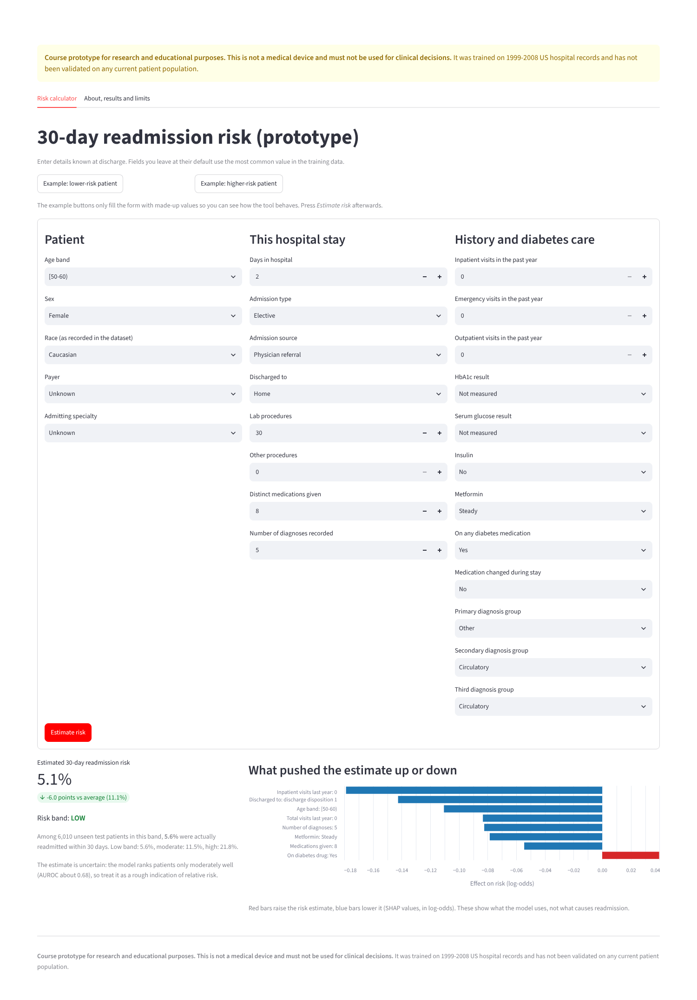
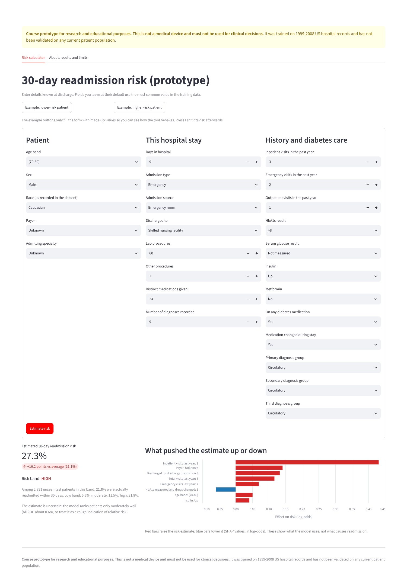

# What the interface gives you: one low-risk and one high-risk example

Both patients are **made up** (they are the two example buttons in the app). Numbers below were produced by the current model (`../model/catboost.cbm`) on 2026-10-26. Everything else not listed is left at the most common training value.

## Example 1: lower-risk patient

**What was entered:** woman aged 50-60, elective admission by physician referral, 2 days in hospital, 30 lab procedures, no other procedures, 8 medications, 5 diagnoses (primary: other), no inpatient, emergency or outpatient visits in the past year, HbA1c not measured, metformin steady, no drug change, discharged home.

**What the app returns**
| Output | Value |
|---|---|
| Estimated 30-day readmission risk | **5.1%** (6.0 points below the 11.1% average) |
| Risk band | **LOW** |
| Observed rate in this band on unseen test patients | 5.6% (6,010 test patients) |
| Main reasons | no inpatient visits last year (lowers risk), discharged home (lowers), age 50-60 (lowers), no visits last year at all, only 5 diagnoses, metformin steady |

## Example 2: higher-risk patient

**What was entered:** man aged 70-80, emergency admission through the emergency room, 9 days in hospital, 60 lab procedures, 2 other procedures, 24 medications, 9 diagnoses (primary: circulatory), **3 inpatient and 2 emergency visits** and 1 outpatient visit in the past year, HbA1c >8, insulin increased, medication changed, discharged to a skilled nursing facility.

**What the app returns**
| Output | Value |
|---|---|
| Estimated 30-day readmission risk | **27.3%** (16.2 points above the 11.1% average) |
| Risk band | **HIGH** |
| Observed rate in this band on unseen test patients | 21.8% (2,891 test patients) |
| Main reasons | 3 inpatient visits last year (raises risk strongly), payer unknown, discharge destination, 6 total visits last year, 2 emergency visits |

## How to read these
- The percentage is calibrated: patients given about 27% are readmitted roughly one time in four, not certainly. The observed rate in the HIGH band on test patients is 21.8%, and in the LOW band 5.6%, so the bands separate groups about four to one.
- The model ranks patients only moderately well (AUROC 0.677, at the working threshold: sensitivity 0.574, specificity 0.666, accuracy 0.655, whereas always answering "no" gives accuracy 0.889 with sensitivity 0), so a single number is a rough indication, not a diagnosis.
- The bars show which inputs the model used (SHAP). They do not show causes. "Payer unknown" appears in the high-risk example only because the dataset's missing-payer value carries signal; it is not a clinical finding.
- Because of a small quirk, the high-risk example sometimes shows **27.1%** instead of 27.3% when the page has only just loaded (see the progress log, 26 Oct); the band and the explanation are the same.
- In the chart the discharge destination currently shows as a code (for example "discharge disposition 3") rather than the plain label; this is a known cosmetic issue.
